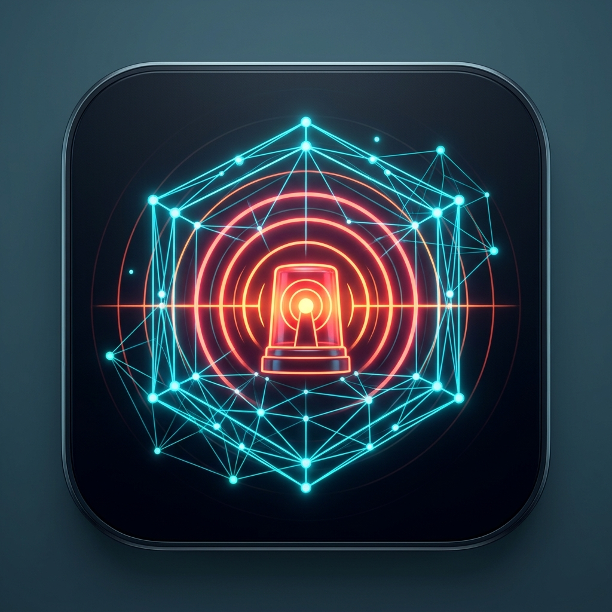
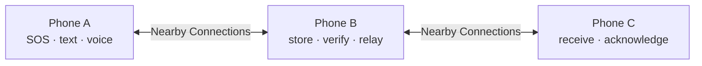

<div align="center">



# AlertMesh

**Offline emergency messaging for nearby Android phones**

Send SOS reports, text, and short voice notes over a local Nearby Connections network when cellular service or internet access is unavailable.

[Download the latest APK](https://github.com/Chatur7x/AlertMesh/releases) · [Feature verification](FEATURE_VERIFICATION.md) · [Production readiness](PRODUCTION_READINESS.md)

</div>

> **Release candidate:** AlertMesh has passed the tests described in this repository, including two-phone Nearby delivery. It is not certified for emergency deployment. Always use official emergency services when they are available.

## At a glance

| | |
|---|---|
| **Emergency SOS** | Tap to add triage details, or hold for 10 seconds to send an automatic report with the latest available location. |
| **Nearby messaging** | Discover other AlertMesh phones and exchange signed text, SOS, and voice messages without a central server. |
| **Recovery** | Save outgoing reports locally and offer them to peers after reconnecting. |
| **Voice** | Record a short AMR-NB note and play a received note through the phone speaker. |
| **Field view** | See connection status, peer count, and live air pressure on phones with a barometer. Peer height is an indicative comparison only. |

The interface uses the [Concept 4 beacon and mesh icon](branding/alertmesh-icon.png) throughout the launcher and app. The [brand sheet](branding/alertmesh-showcase.png) shows the icon at several sizes.

## How it works



Each phone keeps its own identity keys and local message database. Nearby Connections supplies the local radio link. The protocol signs messages, rejects replays and duplicate IDs, and can relay accepted messages while their hop limit remains. A reconnecting peer compares stored message IDs and requests missing reports.

**Security scope:** identity keys are self-signed. Broadcast SOS and voice payloads are signed but are not end-to-end encrypted; targeted text uses recipient encryption when the recipient key is known. Do not treat the network as a trusted emergency authority or a private channel for every message.

## Install

1. Download the newest **AlertMesh APK** from [GitHub Releases](https://github.com/Chatur7x/AlertMesh/releases).
2. Install it on Android 7.0 or newer with Google Play services and Nearby support.
3. Grant location and Nearby/Bluetooth permissions to form the mesh. Microphone permission is needed only for recording voice.
4. Open AlertMesh on two phones. The home screen shows when a peer is connected.
5. For an SOS, tap **Emergency SOS** to complete the form, or hold it for 10 seconds to submit an automatic report.

A submitted report is saved locally. **“Submitted to the mesh” does not mean another person received it.** Check the connection and delivery status.

The release APK is signed with the dedicated AlertMesh release key. An older `com.alertmesh` installation signed with a different key cannot be updated in place; see [release build and migration notes](RELEASE_BUILD.md). Debug builds use `com.alertmesh.devtest` and can be installed alongside the release app.

## Build from source

Requirements: **JDK 21**, Android SDK **36**, and an Android toolchain configured through `local.properties` or `ANDROID_HOME`.

```powershell
./gradlew :protocol:test :server:build :app:assembleDebug :app:lintDebug
```

The debug APK is written to `app/build/outputs/apk/debug/`. To build a signed release, provide the four `ALERTMESH_RELEASE_*` signing variables and set `ALERTMESH_REQUIRE_SIGNED_RELEASE=1`; follow [RELEASE_BUILD.md](RELEASE_BUILD.md). Signing keys and passwords are never committed to this repository.

| Module | Role |
|---|---|
| `app` | Android Compose UI, foreground mesh service, Nearby transport, Room storage, sensors, audio |
| `protocol` | Signed message handling, routing, replay protection, sync, and transport interfaces |
| `server` | Local simulation and topology testing; not required by physical Nearby delivery |

## Verification and limits

The [feature matrix](FEATURE_VERIFICATION.md) records physical device checks and automated tests. The [readiness report](PRODUCTION_READINESS.md) lists open gates, including three-phone radio multi-hop, longer background endurance, large physical reconnect queues, and independent security review. A protocol loopback test is not a substitute for a radio field test.

**AlertMesh is a release candidate, not a replacement for official emergency communications.**
